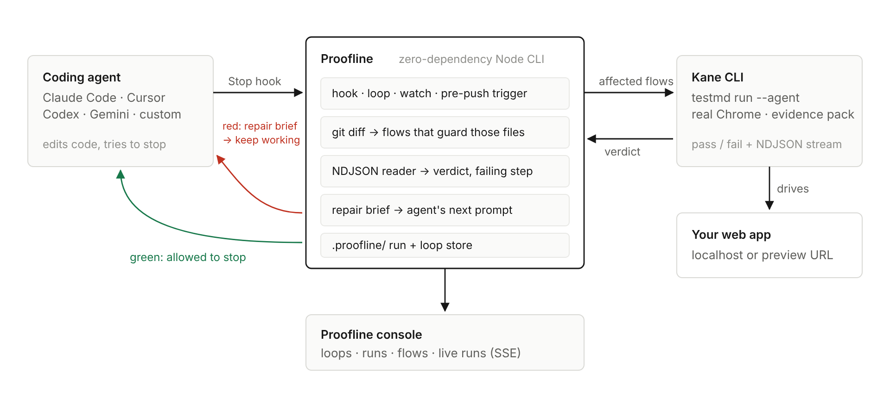
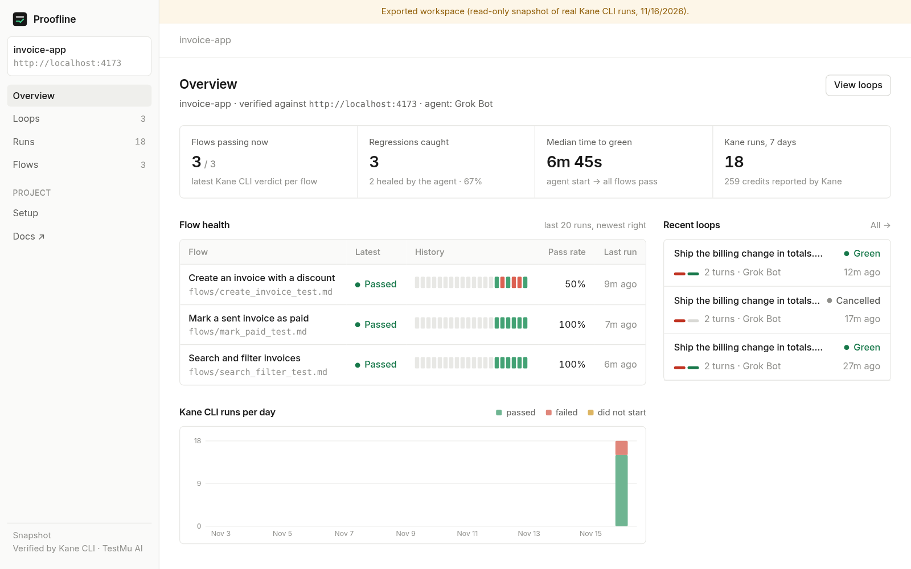
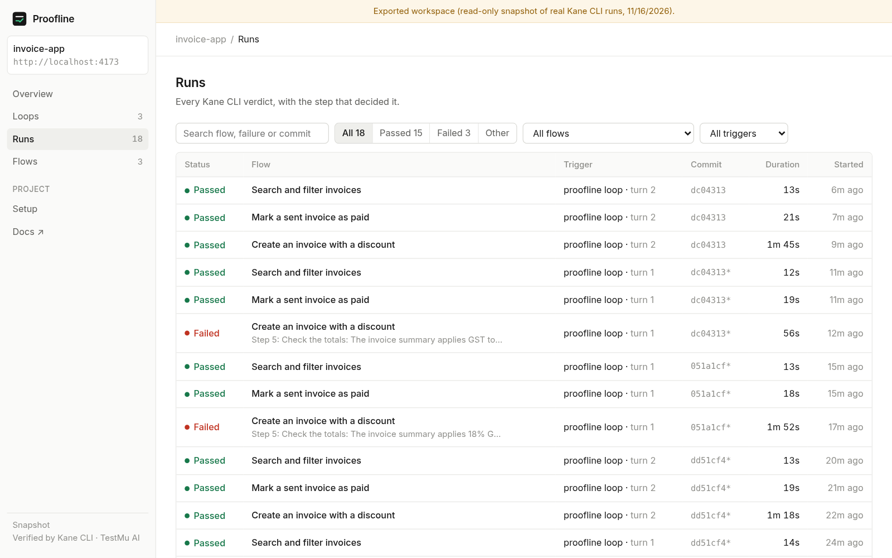

<p align="center"></p>

<h1 align="center">Proofline</h1>
<p align="center"><b>Your coding agent doesn't get to say “done” until Kane CLI says “pass”.</b></p>
<p align="center">
  <a href="https://shine-5705.github.io/proofline/">Hosted console (real Kane runs)</a> ·
  <a href="https://shine-5705.github.io/proofline/example/">Example app</a> ·
  <a href="#quick-start">Quick start</a> ·
  <a href="#how-the-loop-closes">How it works</a>
</p>

---

AI coding agents write features in seconds and then declare victory without ever opening a browser. Proofline puts
[Kane CLI](https://www.testmuai.com/kane-cli/) between the agent and “done”:

1. The agent edits code and tries to stop.
2. Proofline reads `git diff`, picks **only the flows that guard the changed files**, and runs them through
   `kane-cli testmd run --agent` in a real browser.
3. **Green:** the agent may stop. **Red:** Kane's failing step becomes a *repair brief* that is handed back to the
   agent as its next instruction. Repeat, up to a limit, then hand back to a human.
4. Every turn (agent edit → Kane verdict → brief → fix) is recorded and browsable in a local console.

It works with Claude Code and Cursor through their native stop hooks, and with Codex CLI, Gemini CLI or any
command-line agent through `proofline loop`.


<sub>A real loop from 16 Nov 2026, exported from `.proofline/` with `proofline export`. Every verdict is a real Kane CLI run.</sub>

## Real run, 16 Nov 2026

Kane CLI 0.10.4, signed in to Shine's free TestMu AI account, local Chrome (headless), against the bundled example app
on `localhost:4173`. Console with every run: [shine-5705.github.io/proofline](https://shine-5705.github.io/proofline/).

| Step | What happened | Proofline run IDs |
| --- | --- | --- |
| Baseline `proofline check` | Kane authored and passed all 3 flows (create invoice 3m 58s, mark paid 2m 07s, search/filter 2m 27s) | `run_mwjg5r2y0db7ab`, `run_mwjgbc530bf2df`, `run_mwjgekez84ba2d` |
| Plant the bug | `scripts/scenario.mjs break`: GST is charged on the pre-discount subtotal | |
| Loop turn 1 (Kane) | `create_invoice` **failed at step 5, "Check the totals"**. Kane: *"The invoice summary applies GST to the ₹35,000 subtotal instead of the discounted ₹31,500 amount."* The other two flows passed | `run_mwjh7dr7f9440d` (failed), `run_mwjh8sez86d9f9`, `run_mwjh9den6f0931` |
| Loop turn 2 (agent) | **Grok Bot** read the repair brief, changed `subtotal` → `taxable` on line 12 of `totals.js` | |
| Loop turn 2 (Kane) | All 3 flows passed; loop closed green in 6m 38s | `run_mwjhc1k7a50d40`, `run_mwjheqjrcd881d`, `run_mwjhfeq6a121f9` |

Loop `loop_mwjh7db0c20bb3`. The same bug was also caught and fixed in an earlier take (`loop_mwjgozqtc050f4`), and one
take (`loop_mwjh1258515046`) was cancelled by hand because it exposed a real Proofline bug: when the agent's fix brought
the file back to `HEAD`, the empty diff selected no flows, so the loop would have closed without re-running Kane.
Fixed in the following commit: a loop always re-checks the flows that failed on the previous turn.

**Who the agent was.** The box this ran on has no Claude Code or Cursor, so the coding agent was **Grok Bot** (the
assistant that built this project) plugged in with `--agent-command "node scripts/handoff-agent.mjs {brief}"`: Proofline
drops the repair brief in `.proofline/inbox/`, Grok Bot reads it, edits the code and signals done, and Proofline re-runs
Kane. The Claude Code and Cursor stop hooks are implemented and covered by the test suite, but were not exercised in a
real Claude Code or Cursor session for this run. The bug was planted on purpose by `scripts/scenario.mjs`.

Kane's own screenshots of step 5 before and after the fix: [failed](docs/real-run/screenshots/kane-step5-failed-run_mwjh7dr7f9440d.png), [passed](docs/real-run/screenshots/kane-step5-passed-run_mwjhc1k7a50d40.png).

Credits: the account went from 1,200 to about 868 (about 330 credits). First-time authoring of the 3 flows cost the
most (about 207 as reported by Kane). After that, Kane replays the recorded steps and only re-reasons about the step
that changed.

## Why

| Without Proofline | With Proofline |
| --- | --- |
| Agent says “done”; you open the browser to find out | Agent can't finish until Kane's real-browser run passes |
| Every check runs every test, or none | `git diff` → only the flows that guard those files |
| A failure is a red CI badge hours later | The failing step is the agent's next prompt, seconds later |
| No record of what the agent tried | Each turn, diff, verdict and brief is kept in `.proofline/` |

## Quick start

```bash
# 1. Kane CLI + a free TestMu AI account
npm install -g @testmuai/kane-cli
kane-cli login --oauth

# 2. Proofline in your repo
npm install -D github:Shine-5705/proofline
npx proofline init --hooks claude,cursor   # config, a starter flow, agent hooks. Never overwrites files.

# 3. Baseline, then let the hook take over
npx proofline check
npx proofline ui                           # http://localhost:4317
```

### Try it on the bundled example (one command)

```bash
git clone https://github.com/Shine-5705/proofline && cd proofline
npm run demo        # example app on :4173, Proofline console on :4317
```

Then, with Kane CLI signed in:

```bash
cd examples/invoice-app
node ../../bin/proofline.mjs check                  # all 3 flows through Kane CLI
node ../../scripts/scenario.mjs break               # plant a real invoicing bug (GST ignores the discount)
node ../../bin/proofline.mjs loop "Fix whatever Kane finds" --verify-first --agent claude
# or with any agent that is not a local CLI (this is how the real run above was driven):
node ../../bin/proofline.mjs loop "Fix whatever Kane finds" --verify-first --agent-command "node ../../scripts/handoff-agent.mjs {brief}"
```

`--verify-first` runs Kane before the agent's first turn, so the loop starts from a red run: Kane fails
`create_invoice` at the totals step, the brief goes to the agent, the agent fixes `totals.js`, Kane passes, loop closes.

The example already ships with the Claude Code and Cursor stop hooks (`examples/invoice-app/.claude/settings.json`,
`.cursor/hooks.json`): open `examples/invoice-app` in either agent and the loop runs on its own.
Full walkthrough: [docs/REAL_RUN.md](docs/REAL_RUN.md).

## How the loop closes



| Trigger | How Kane's verdict reaches the agent |
| --- | --- |
| **Claude Code** `Stop` hook | `proofline hook claude` prints `{"decision":"block","reason":<brief>}`, so Claude keeps working on the failure |
| **Cursor** `stop` hook | `proofline hook cursor` prints `{"followup_message":<brief>}`, which Cursor submits as the next message |
| **Any CLI agent** | `proofline loop "<task>" --agent codex\|gemini\|claude\|cursor\|custom` re-invokes the agent with the brief |
| **Hosted / chat agents** | `--agent-command "node scripts/handoff-agent.mjs {brief}"` puts the brief in `.proofline/inbox/` and waits for the agent's edit (how Grok Bot ran the real loop) |
| **On save** | `proofline watch` re-verifies affected flows on every file change |
| **git pre-push** | `proofline init --hooks git` blocks the push while a guarding flow is red |
| **CI** | `.github/workflows/kane.yml` runs every flow with `LT_USERNAME` / `LT_ACCESS_KEY` secrets |

Guard rails: a per-session attempt counter (default 4) stops runaway loops; a run Kane refuses to start
(not signed in, no Chrome) is reported as **blocked**, never as a pass or a code failure.

### Flows and what they guard

Flows are ordinary Kane CLI `*_test.md` files: plain English, no selectors. Proofline maps each to the files it guards
in `proofline.config.json`:

```json
{
  "baseUrl": "http://localhost:4173",
  "flowsDir": "flows",
  "agent": "claude",
  "maxIterations": 4,
  "globalCovers": ["index.html", "styles.css"],
  "coverage": {
    "flows/create_invoice_test.md": ["totals.js", "app.js"],
    "flows/mark_paid_test.md": ["app.js", "data.js"]
  }
}
```

A flow with no mapping guards everything (`**`) **until Proofline learns what it touches**: the bundled dev server, or
`proofline proxy --target http://localhost:5173` in front of yours, records every file the browser requests while Kane
runs a flow. After a passing run, those files become the flow's guarded set (`.proofline/learned-coverage.json`), so a
change to a file no flow ever loaded re-runs nothing. Works with static servers and Vite-style dev servers that serve
source modules by path. Editing a flow file always re-runs that flow.

### Dogfooding

`console/flows/` holds Kane CLI flows for Proofline's own hosted console (open a loop, read the brief, filter runs,
against the `?demo` workspace), and the CI workflow (enabled once TestMu AI secrets are added) runs them alongside the
example app's flows. They have not been run with real credits yet.

## The console

`proofline ui` serves a local console over `.proofline/` and can start Kane runs itself, streaming steps live.

| Overview | Runs | Flow |
| --- | --- | --- |
|  |  |  |

- **Overview**: flows passing now, regressions caught and healed, median time to green, runs per day.
- **Loops**: every agent ↔ Kane exchange, with diffs, failing steps and the exact brief the agent received.
- **Runs**: filter by status, flow, trigger; search failures; step-by-step detail, raw NDJSON, rerun command.
- **Flows**: steps, guarded files, duration trend (replays get faster once Kane caches a recording), *Run with Kane CLI*.
- **Setup**: live readiness check (kane-cli installed, signed in, credits, hooks, flows).

The [hosted console](https://shine-5705.github.io/proofline/) serves a read-only snapshot of the real runs above
(`console/public/workspace.json`, written by `proofline export`). The older illustrative sample workspace is still
available at [`?demo`](https://shine-5705.github.io/proofline/?demo), bannered as sample data on every page. To publish
your own history: `npx proofline export console/public/workspace.json`.

## Commands

```
proofline init [--url <baseUrl>] [--agent claude|codex|cursor|gemini] [--hooks claude,cursor,git]
proofline check [--changed] [--since <ref>] [--flow <id,...>]
proofline loop "<task>" [--max <n>] [--verify-first] [--agent <name>] [--agent-command "<cmd {brief}>"]
proofline watch
proofline hook claude|cursor|git
proofline ui [--port 4317]
proofline proxy [--target <devServerUrl>] [--port 4174]
proofline export [file]
proofline doctor
```

Exit codes follow Kane CLI: `0` green, `1` a flow failed, `2` Kane did not start.

## Repository layout

```
bin/proofline.mjs        CLI entry
src/kane.mjs             spawns kane-cli, folds the NDJSON stream into a verdict
src/flows.mjs            discovers *_test.md flows, maps changed files → flows
src/coverage.mjs         learned coverage: files the browser loaded during each passing Kane run
src/brief.mjs            failed runs → repair brief
src/commands/            check · loop · hook · watch · init · doctor
src/server.mjs           console API: workspace, runs, readiness, POST /api/check, SSE /api/events
console/                 React + TypeScript console (Vite), hand-built design system, SVG charts
examples/invoice-app/    “Tally”, a small invoicing app + three Kane flows (the app under test)
scripts/                 demo, example server, scenario (planted regression), handoff agent adapter, sample-data generator, run reindexer
test/                    node:test suite; fixtures/fake-kane.mjs is a test double for plumbing tests only
```

## Development

```bash
npm test                                   # 13 tests, no network, no credits
npm --prefix console install
npm run console:dev                        # Vite dev server, proxies /api to proofline ui on :4317
npm run console:build
```

The test double in `test/fixtures/` lets the hook and loop plumbing be tested without credits. It is never used by the
CLI unless `PROOFLINE_KANE_BIN` points at it, and nothing it produces is presented as a Kane result.

## Built with

- [Kane CLI](https://github.com/LambdaTest/kane-cli) by TestMu AI (Apache-2.0): the verifier. Proofline shells out to it.
- [React](https://react.dev) and [Vite](https://vitejs.dev) (MIT) for the console; [Inter](https://rsms.me/inter/) via
  [@fontsource-variable/inter](https://fontsource.org) (OFL-1.1).
- The CLI itself has zero runtime dependencies.

Built for the **Kane CLI Online Hackathon** (TestMu AI, 12–19 Nov 2026) by Shine Gupta (TheAdaply, Bengaluru).

## License

MIT © 2026 Shine Gupta
