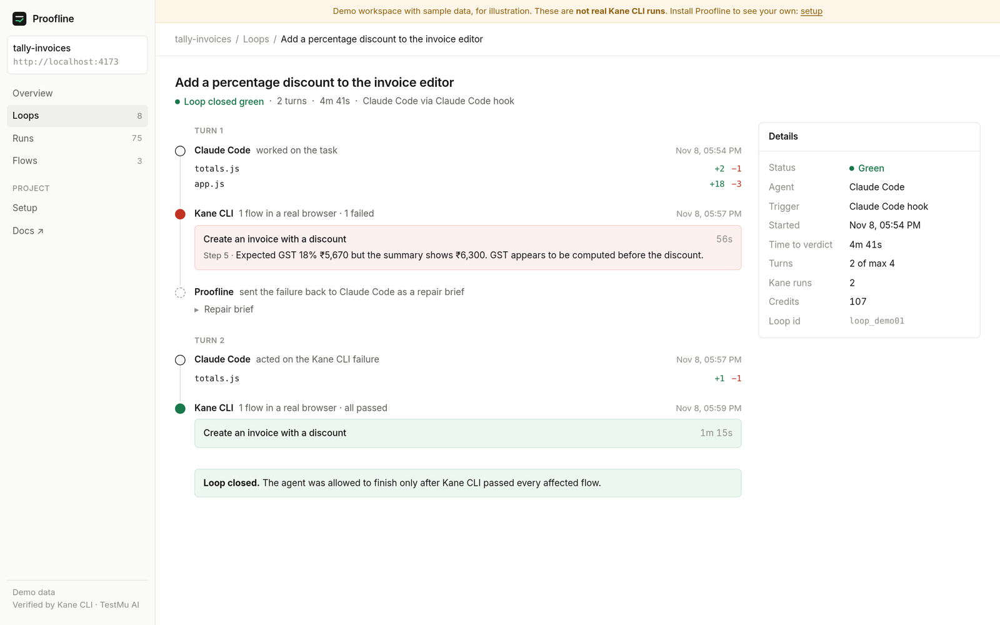
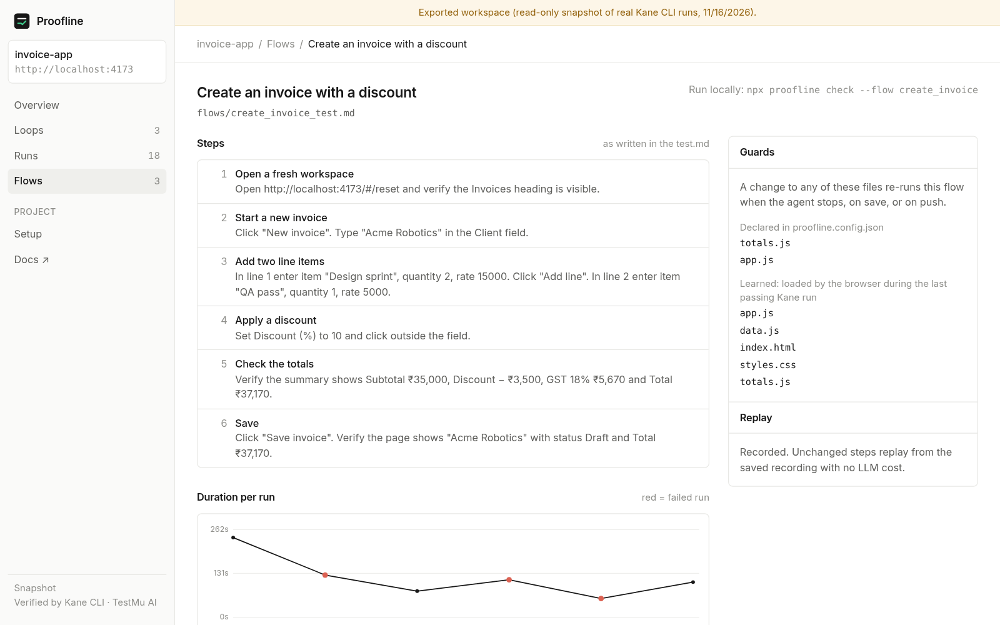

<p align="center"></p>

<h1 align="center">Proofline</h1>
<p align="center"><b>Your coding agent doesn't get to say “done” until Kane CLI says “pass”.</b></p>
<p align="center">
  <a href="https://shine-5705.github.io/proofline/">Hosted console (sample data)</a> ·
  <a href="https://shine-5705.github.io/proofline/example/">Example app</a> ·
  <a href="#quick-start">Quick start</a> ·
  <a href="#how-the-loop-closes">How it works</a>
</p>

---

AI coding agents write features in seconds and then declare victory without ever opening a browser. Proofline puts
[Kane CLI](https://www.testmuai.com/kane-cli/) between the agent and “done”:

1. The agent edits code and tries to stop.
2. Proofline reads `git diff`, picks **only the flows that guard the changed files**, and runs them through
   `kane-cli testmd run --agent` in a real browser.
3. **Green:** the agent may stop. **Red:** Kane's failing step becomes a *repair brief* that is handed back to the
   agent as its next instruction. Repeat, up to a limit, then hand back to a human.
4. Every turn (agent edit → Kane verdict → brief → fix) is recorded and browsable in a local console.

It works with Claude Code and Cursor through their native stop hooks, and with Codex CLI, Gemini CLI or any
command-line agent through `proofline loop`.


<sub>Console screenshots use the labelled sample workspace from the hosted demo.</sub>

## Why

| Without Proofline | With Proofline |
| --- | --- |
| Agent says “done”; you open the browser to find out | Agent can't finish until Kane's real-browser run passes |
| Every check runs every test, or none | `git diff` → only the flows that guard those files |
| A failure is a red CI badge hours later | The failing step is the agent's next prompt, seconds later |
| No record of what the agent tried | Each turn, diff, verdict and brief is kept in `.proofline/` |

## Quick start

```bash
# 1. Kane CLI + a free TestMu AI account (10,000 credits for a month)
npm install -g @testmuai/kane-cli
kane-cli login --oauth

# 2. Proofline in your repo
npm install -D github:Shine-5705/proofline
npx proofline init --hooks claude,cursor   # config, a starter flow, agent hooks. Never overwrites files.

# 3. Baseline, then let the hook take over
npx proofline check
npx proofline ui                           # http://localhost:4317
```

### Try it on the bundled example (one command)

```bash
git clone https://github.com/Shine-5705/proofline && cd proofline
npm run demo        # example app on :4173, Proofline console on :4317
```

Then, with Kane CLI signed in:

```bash
cd examples/invoice-app
node ../../bin/proofline.mjs check                  # all 3 flows through Kane CLI
node ../../scripts/scenario.mjs break               # plant a real invoicing bug (GST ignores the discount)
node ../../bin/proofline.mjs loop "Fix whatever Kane finds" --verify-first --agent claude
```

`--verify-first` runs Kane before the agent's first turn, so the loop starts from a red run: Kane fails
`create_invoice` at the totals step, the brief goes to the agent, the agent fixes `totals.js`, Kane passes, loop closes.

The example already ships with the Claude Code and Cursor stop hooks (`examples/invoice-app/.claude/settings.json`,
`.cursor/hooks.json`): open `examples/invoice-app` in either agent and the loop runs on its own.
Full walkthrough: [docs/REAL_RUN.md](docs/REAL_RUN.md).

## How the loop closes


| Trigger | How Kane's verdict reaches the agent |
| --- | --- |
| **Claude Code** `Stop` hook | `proofline hook claude` prints `{"decision":"block","reason":<brief>}`, so Claude keeps working on the failure |
| **Cursor** `stop` hook | `proofline hook cursor` prints `{"followup_message":<brief>}`, which Cursor submits as the next message |
| **Any CLI agent** | `proofline loop "<task>" --agent codex\|gemini\|claude\|cursor\|custom` re-invokes the agent with the brief |
| **On save** | `proofline watch` re-verifies affected flows on every file change |
| **git pre-push** | `proofline init --hooks git` blocks the push while a guarding flow is red |
| **CI** | `.github/workflows/kane.yml` runs every flow with `LT_USERNAME` / `LT_ACCESS_KEY` secrets |

Guard rails: a per-session attempt counter (default 4) stops runaway loops; a run Kane refuses to start
(not signed in, no Chrome) is reported as **blocked**, never as a pass or a code failure.

### Flows and what they guard

Flows are ordinary Kane CLI `*_test.md` files: plain English, no selectors. Proofline maps each to the files it guards
in `proofline.config.json`:

```json
{
  "baseUrl": "http://localhost:4173",
  "flowsDir": "flows",
  "agent": "claude",
  "maxIterations": 4,
  "globalCovers": ["index.html", "styles.css"],
  "coverage": {
    "flows/create_invoice_test.md": ["totals.js", "app.js"],
    "flows/mark_paid_test.md": ["app.js", "data.js"]
  }
}
```

A flow with no mapping guards everything (`**`). Editing a flow file always re-runs that flow.

## The console

`proofline ui` serves a local console over `.proofline/` and can start Kane runs itself, streaming steps live.

| Overview | Runs | Flow |
| --- | --- | --- |
|  |  |  |

- **Overview**: flows passing now, regressions caught and healed, median time to green, runs per day.
- **Loops**: every agent ↔ Kane exchange, with diffs, failing steps and the exact brief the agent received.
- **Runs**: filter by status, flow, trigger; search failures; step-by-step detail, raw NDJSON, rerun command.
- **Flows**: steps, guarded files, duration trend (replays get faster once Kane caches a recording), *Run with Kane CLI*.
- **Setup**: live readiness check (kane-cli installed, signed in, credits, hooks, flows).

The [hosted console](https://shine-5705.github.io/proofline/) runs on a **sample workspace** (`mode: "demo"`,
bannered on every page) because GitHub Pages can't run Kane. To publish your own real history instead:
`npx proofline export console/public/demo-workspace.json`.

## Commands

```
proofline init [--url <baseUrl>] [--agent claude|codex|cursor|gemini] [--hooks claude,cursor,git]
proofline check [--changed] [--since <ref>] [--flow <id,...>]
proofline loop "<task>" [--max <n>] [--verify-first] [--agent <name>]
proofline watch
proofline hook claude|cursor|git
proofline ui [--port 4317]
proofline export [file]
proofline doctor
```

Exit codes follow Kane CLI: `0` green, `1` a flow failed, `2` Kane did not start.

## Repository layout

```
bin/proofline.mjs        CLI entry
src/kane.mjs             spawns kane-cli, folds the NDJSON stream into a verdict
src/flows.mjs            discovers *_test.md flows, maps changed files → flows
src/brief.mjs            failed runs → repair brief
src/commands/            check · loop · hook · watch · init · doctor
src/server.mjs           console API: workspace, runs, readiness, POST /api/check, SSE /api/events
console/                 React + TypeScript console (Vite), hand-built design system, SVG charts
examples/invoice-app/    “Tally”, a small invoicing app + three Kane flows (the app under test)
scripts/                 demo, example server, scenario (planted regression), sample-data generator
test/                    node:test suite; fixtures/fake-kane.mjs is a test double for plumbing tests only
```

## Development

```bash
npm test                                   # 12 tests, no network, no credits
npm --prefix console install
npm run console:dev                        # Vite dev server, proxies /api to proofline ui on :4317
npm run console:build
```

The test double in `test/fixtures/` lets the hook and loop plumbing be tested without credits. It is never used by the
CLI unless `PROOFLINE_KANE_BIN` points at it, and nothing it produces is presented as a Kane result.

## Built with

- [Kane CLI](https://github.com/LambdaTest/kane-cli) by TestMu AI (Apache-2.0): the verifier. Proofline shells out to it.
- [React](https://react.dev) and [Vite](https://vitejs.dev) (MIT) for the console; [Inter](https://rsms.me/inter/) via
  [@fontsource-variable/inter](https://fontsource.org) (OFL-1.1).
- The CLI itself has zero runtime dependencies.

Built for the **Kane CLI Online Hackathon** (TestMu AI, 12–19 Nov 2026) by Shine Gupta (TheAdaply, Bengaluru).

## License

MIT © 2026 Shine Gupta
